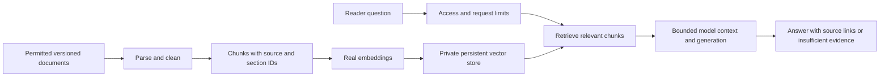

# Architecture decision proposal

## Choice and alternatives

Recommend vector-first retrieval for passage-oriented explanations and paraphrases. Use a bounded keyword baseline to test whether semantic retrieval improves Q02 without degrading exact identifiers in Q01/Q03. Graph-only would make explicit route relationships easy to traverse but needs validated entities/edges and question-to-query rules; five short documents do not yet justify operating two databases. Combined retrieval remains a later experiment, not required scope. Learner adoption/reason pending.

Proposed stack: FastAPI interface/API; Qdrant private persistent vector store; a compatible local embedding model; an available generation provider behind the server. Exact embedding/generation model, package versions and provider access must be confirmed before Build. No paid subscription selected. No benchmark result claimed. Smaller scope fallback: keep only these five fixtures and reduce context/concurrency, retaining real retrieval and generation for Build.

## Planned flow

Source and chunk IDs, section, content hash, source version and access scope travel with each passage. Never treat corpus instructions as system authority. Use the same embedding model/configuration for content and query; reindex when changing incompatible models. A vector represents text numerically; similarity does not verify truth.

## Graph research sketch

Nodes: Router(calc-route), EntryPoint(websecure), Service(calc-service), Application(calculator). Typed edges USES_ENTRYPOINT, SELECTS_SERVICE, TARGETS_APPLICATION; each retains S02 section support. Do not infer an actual production graph from this synthetic scenario. Neo4j is an alternative property-graph database, not an additional required service.

## Import behavior and permissions

Use document ID + section/chunk identity plus a version/content hash. Unchanged reimport should be a no-op; updates replace stale units; removed sources delete stale retrievable units. Validate manifest/source text, reject missing IDs and record outcomes. These operations remain planned.

## Hosting and resource envelope — proposed, unmeasured

Reuse existing Docker/Traefik only after reviewing its actual app/network compatibility. Do not replace proxies or unrelated services. Database binds only to a private application network; persistent volume for its index plus original fixtures in Git. Proposed initial app limits: 2,000-character question, five retrieved passages, bounded output, one concurrent generation, 10 requests/minute/client and a server-wide daily cap. Tune from measured memory/latency. Do not promise these limits are enforced yet.

Model-access question: confirm an existing provider account or feasible local generation before selecting versions/budget. Keep keys off Git and out of browser responses. Budget approval is needed before spending; no spending authorized here. Instructor workshop Nov 10/12 is the next step if access/resources remain unresolved. A running app is not required for Review 1.

## Sources

[Vector representations](https://qdrant.tech/documentation/overview/vector-search/) · [Property graphs](https://neo4j.com/docs/getting-started/appendix/graphdb-concepts/) · [Keyword baseline](https://www.postgresql.org/docs/18/textsearch-intro.html) · [Original RAG paper](https://arxiv.org/abs/2005.11401v4). AI accessed November 8, 2026. Vendor facts do not prove this proposed architecture works.
